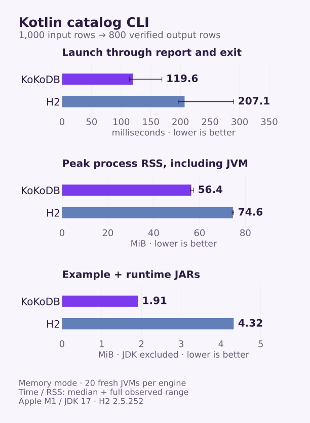
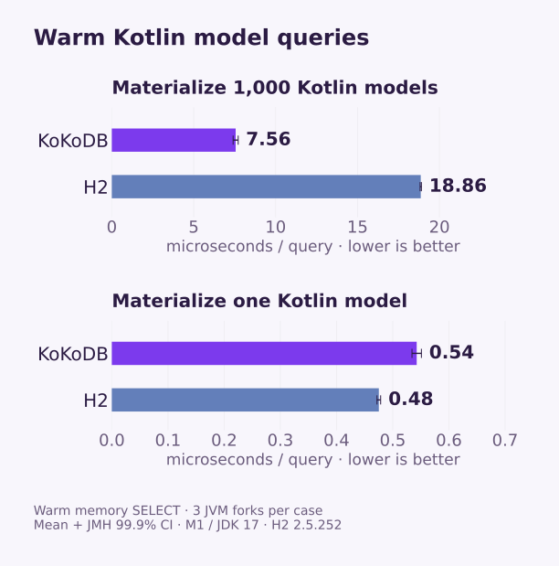

<p></p>

**Keep your Kotlin app small, even when it needs SQL.**

KoKoDB is a small embedded SQL database for Kotlin/JVM. Define a model, query it with SQL, and receive Kotlin objects directly.

**Alpha · JDK 17 · Source checkout required.** [Try it](#try-it) · [API guide](docs/usage.md) · [Supported scope](#current-alpha-scope)

```kotlin
@DbTable("files")
data class FileEntry(
    @Id val id: Int,
    val path: String,
    val kind: String,
)

val sources = KoKoDB<FileEntry>(
    "SELECT * FROM files WHERE kind = :kind",
    mapOf("kind" to "source"),
)
```

The result is a `List<FileEntry>`. KSP generates the table schema and row mapper from your model, and KoKoDB creates the table on first use. The default database is in memory. The [runnable quickstart](examples/quickstart/src/main/kotlin/quickstart/Main.kt) includes imports, writes and cleanup.

- **Declare your data once.** Use one model for storage and complete typed query results. Schema registration and row construction are generated at build time.
- **Keep database work together.** Queries and writes share one API across your application. Explicit transactions group related changes atomically.
- **Add a small runtime.** The measured engine JAR is **159 KiB**, with Kotlin stdlib and annotations as separate dependencies. KSP runs at build time. [Artifact and process measurements](#measured-cost-against-h2)

The current alpha targets small working datasets: single-table CRUD, non-null `Int`/`String` fields and equality filters. It supports [raw SQL](docs/usage.md#raw-sql) independently of models and KSP.

## Replace a working catalog atomically

Consider a Kotlin tool that keeps a file catalog and queries it through SQL. When it imports a replacement, a duplicate id halfway through the input must leave the previous catalog intact. The shared database publishes the replacement when the whole transaction succeeds:

```kotlin
fun replaceCatalog(entries: List<FileEntry>) {
    KoKoDB.transaction {
        KoKoDB("DELETE FROM files")
        for (entry in entries) {
            KoKoDB(
                "INSERT INTO files VALUES (:id, :path, :kind)",
                mapOf("id" to entry.id, "path" to entry.path, "kind" to entry.kind),
            )
        }
    }
}
```

Query functions continue to use `KoKoDB<FileEntry>(sql, params)`. The shared database owns primary-key validation and rollback; callers on other threads wait until the scope finishes. Models are detached, so writes stay explicit. [Transaction and lifetime contracts](docs/usage.md#memory-transactions)

This is useful when SQL is already the interface your application wants for its working data, and replacements must succeed as a whole. A one-off list transformation can stay a Kotlin collection. KoKoDB provides the shared query and transaction boundary for applications that need it.

## Try it

From a checkout with JDK 17, run the complete example:

```sh
git clone https://github.com/xhae123/kokodb.git
cd kokodb
./gradlew :quickstart:run
```

The example loads a catalog, queries its source files, attempts an invalid replacement, verifies that all original rows survived, then commits a valid replacement. Its application output is:

```text
Source files: [src/Main.kt]
Duplicate id rejected; original catalog preserved.
Replacement committed; source files: [src/New.kt]
```

Edit [Main.kt](examples/quickstart/src/main/kotlin/quickstart/Main.kt) to try your own data. The [module configuration](examples/quickstart/build.gradle.kts) includes the runtime and KSP processor; the Gradle wrapper downloads the pinned build tools and dependencies on first use. Nothing is published to Maven Central yet. For the consumer setup and raw SQL alternative, see the [build guide](docs/usage.md#build-setup).

## Measured cost against H2

For applications where dependency size and process overhead matter, we measure the full path from JVM launch to completed work. The separate [catalog benchmark example](examples/catalog/README.md) imports 1,000 entries, renames one, removes 200 generated entries, and writes an 800-row report. It measures a fixed workflow; it is not a customer deployment or the quickstart above.

Both engines produce the same bytes, checked against an independent reference across all 40 measured runs. H2 uses prepared statements, batch INSERTs and direct Kotlin constructor mapping. Compare the [KoKoDB](examples/catalog/src/main/kotlin/catalog/KokoCatalog.kt) and [H2](examples/catalog/src/main/kotlin/catalog/JdbcCatalog.kt) implementations.

<p></p>

*Figure 1. Complete CLI cost. Purple: KoKoDB; blue: H2. Time and RSS bars show medians, with whiskers for the full observed range across 20 fresh JVMs per engine. JAR sizes are measured artifact totals. All axes start at zero. [Workload, raw observations and reproduction steps](docs/baselines/2026-10-23-catalog-cli/README.md).*

| In-memory catalog CLI | KoKoDB | H2 2.5.252 |
|---|---:|---:|
| Launch through report generation and exit | **119.6 ms** | 207.1 ms |
| Peak process RSS, including the JVM | **56.4 MiB** | 74.6 MiB |
| Example + runtime JARs, excluding the JDK | **1.91 MiB** | 4.32 MiB |

In this fixture, that is **87 ms less elapsed time (42%)**, **18 MiB less peak RSS**, and **2.4 MiB less JAR payload**.

*Medians of 20 fresh JVMs per engine, Apple M1 / macOS / JDK 17. Both databases are in memory. Each process loads only its selected engine, with the same example and Kotlin dependencies. Timings include input, SQL, mapping, sorting, output and close; Gradle compilation is excluded.*

### Query cost depends on the result size

The separate warmed-query study measures materializing complete Kotlin models. KoKoDB takes **7.56 µs** for a 1,000-model list versus H2's **18.86 µs**. For a single model, H2 leads: **0.48 µs** versus **0.54 µs**. These are query timings after warmup, not JVM startup timings.

<p></p>

*Figure 2. Warm memory SELECT with three JVM forks per case. Bars show means; whiskers show JMH 99.9% confidence intervals, unlike Figure 1's observed ranges. Purple: KoKoDB; blue: H2. Both panels start at zero and use different scales. [Full query study, including point reads and allocation](docs/baselines/2026-10-23-engine-comparison/README.md).*

H2 also leads in the study's primary-key reads. These workloads do not establish service-request latency or file-mode performance. The [complete results](docs/baselines/2026-10-23-catalog-cli/README.md) retain ranges, artifact hashes and reproduction steps.

## Current alpha scope

Evaluate KoKoDB when the following scope covers your application's work:

- **SQL and models:** Single-table CRUD, one optional equality predicate, non-null `Int`/`String`, caller-supplied primary keys and complete mapped results.
- **Transactions:** Atomic statements and explicit synchronous transactions. Shared calls are serialized.
- **Storage:** Memory by default; experimental file storage with WAL recovery and manual checkpoints on qualified Linux/macOS filesystems.

Joins, NULL, SQL sorting/aggregation, additional types, generated keys, arbitrary DTO mapping, automatic schema migration, coroutine transaction scopes and concurrent independent transactions are outside the current scope. H2 is also a server-free JVM database and has a [broader feature set](https://h2database.com/html/features.html).

Memory data is discarded on close or process exit. File storage requires explicit `KoKoDB.open(path)`; the whole catalog still resides in memory. Production use remains unqualified. Read the [storage guarantees](docs/transactions-and-persistence.md) and [backup/restore guide](docs/operating-file-databases.md) before trying files.

Typed results do not imply compile-time SQL correctness. The optional [SQL compiler plugin](docs/compile-time-sql-validation.md) checks static syntax and call categories; schema, projection, parameter and constraint checks remain runtime guarantees.

## Development and evidence

- [Alpha acceptance](docs/alpha.md): correctness, failure injection, recovery and Kotlin consumer checks, with remaining release gates.
- [Complete CLI measurements](docs/baselines/2026-10-23-catalog-cli/README.md) and [engine comparison](docs/baselines/2026-10-23-engine-comparison/README.md): workloads, raw results and reproducible commands.
- [API and architecture](docs/usage.md) · [Roadmap](docs/roadmap.md) · [Benchmark guide](comparison/README.md).

## License

[MIT](LICENSE) © 2026 xhae123.
