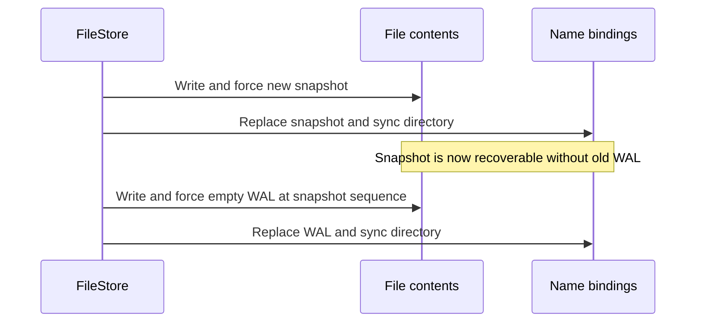

# Persistence Ordering Under Modeled Crashes

Process termination leaves operating-system caches intact. I/O exceptions can test error handling while newly written data still remain readable. Neither alone tests whether a checkpoint can lose its new snapshot while retaining the reset WAL.

This qualification records the production storage protocol and materializes candidate disk states with unforced effects removed. It adds regression coverage for ordering; it does not change the storage format, public API, force policy, or supported platforms.

## Model and oracle

- `PersistenceModelIO` delegates actual operations to StoreIO and separately tracks file contents and authoritative snapshot/WAL bindings. The two new internal seams, channel open and truncate, retain their existing FileChannel behavior.
- Each file starts with known persisted bytes. Until force, every prefix of a small append may survive; a truncation may survive or be lost. Force fixes the complete current contents, including length.
- A replacement changes the live name binding. Until directory sync, each name may independently retain its previous binding or any pending replacement. This includes a new WAL with an old snapshot if a required directory barrier is removed.
- Directory sync fixes the name bindings, without implicitly forcing file contents. File force does not implicitly persist a replacement.
- Images are deduplicated by file names, contents and acknowledgment state. Temporary names and lock-file contents are excluded. Fixtures limit each append to 4 KiB because enumerating every byte prefix is deliberately bounded.
- At each capture, the model checks its live authoritative bytes and bindings against the actual files. Paths are canonicalized to match FileStore, including macOS temporary-directory aliases.
- Each image is written into an isolated directory and passed through real `Database.open`. The oracle checks known acknowledged rows and transaction atomicity, then commits more rows, checkpoints, and reopens again.

The commit fixture updates two tables and creates/populates a third in one transaction. Before acknowledgment, either the whole old state or the whole new state is allowed. After acknowledgment, all changes are required.



## Results

| Path | Distinct crash images | Required result |
|---|---:|---|
| Bootstrap | 4 | Open a valid empty database, then persist new data |
| Multi-table commit with table creation | 198 | Preserve prior commits and expose all or none of the new transaction |
| Checkpoint | 4 | Preserve every acknowledged row across either authoritative file pair |
| Torn-tail repair | 3 | Preserve the valid prefix whether truncation survives or is lost |
| Legacy WAL migration | 4 | Recover the same rows before or after format migration |
| Snapshot-covered stale WAL | 3 | Retain the snapshot contents while resetting the older WAL |
| **Total** | **216** | **Recover, write, checkpoint and reopen successfully** |

The 196-byte commit frame contributes all 197 prefix lengths, including zero and the complete frame. Its acknowledged image is a separate case. Multiple operation cuts can produce the same persisted state, so these counts are distinct images rather than operation or test-method counts.

| Deliberately omitted barrier | Detected failure |
|---|---|
| Commit WAL force | An acknowledged transaction is absent after recovery |
| Checkpoint snapshot force | The renamed snapshot can have an invalid persisted length |
| Checkpoint snapshot directory sync | The new WAL can survive with an older snapshot, rejecting the history pair |
| Bootstrap WAL directory sync | The snapshot can survive without its required WAL |

All four negative controls are tests that **pass only when the omitted barrier causes a violation**. They guard against a model that accidentally persists every write or couples unrelated directory changes.

## Reproduction

```sh
./gradlew :test --tests kokodb.storage.PersistenceOrderingTest
```

The two test methods print per-path image counts, actual operation traces and negative-control detections in the JUnit XML report. The production protocol starts from commit `3d9d5217e3f6b365b5c087fab1cd0021af4a5040`; the internal seam additions do not change operation ordering. Raw test output and environment details are retained alongside this document.

## Limits and assumptions

- Successful force and directory sync are assumed to satisfy their contracts. This does not test a device or filesystem that falsely acknowledges a barrier.
- Per-name replacement is atomic. Append damage is limited to retained prefixes, and truncation to old/new length. The model does not enumerate sector reordering, torn sectors, garbage in an unforced write, or damage to previously forced bytes.
- Corrupt complete frames still fail closed. Successful recovery after arbitrary unforced-tail corruption is not established by the prefix model.
- Temporary-file persistence, lock behavior, channel lifecycle and cleanup failures are outside this model. The separate I/O-exception and child-process tests remain necessary.
- Counts describe finite fixtures, not exhaustive database correctness. Test elapsed time is not a performance benchmark.
- No deployment, publication, license change or broader hardware durability claim accompanies this work.

## Primary references

- [Java 17 FileChannel](https://docs.oracle.com/en/java/javase/17/docs/api/java.base/java/nio/channels/FileChannel.html#force(boolean)) defines file force and its local-storage qualifications.
- [Linux fsync](https://man7.org/linux/man-pages/man2/fsync.2.html) distinguishes file synchronization from persisting its directory entry.
- [SQLite atomic commit testing](https://www.sqlite.org/atomiccommit.html#_testing_atomic_commit_behavior) motivates testing simulated incomplete and reordered persistence. KoKoDB's finite prefix/binding model is narrower and uses its own snapshot/WAL protocol.
